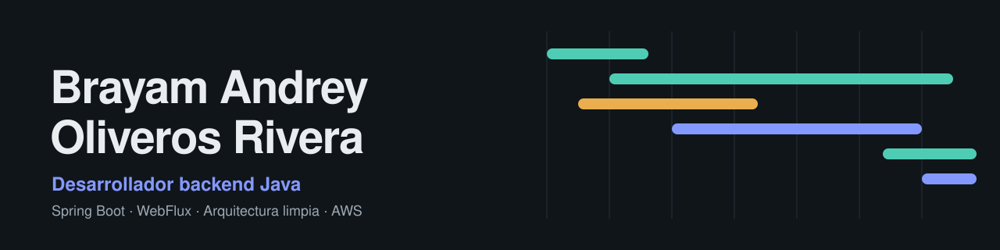
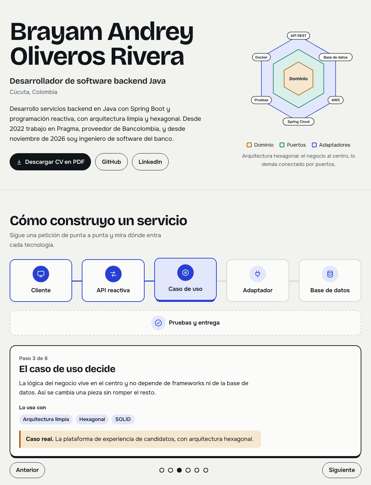
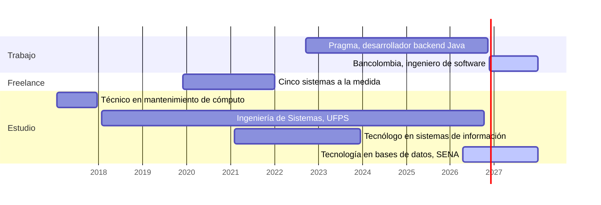

<p align="center">
  
</p>

<p align="center">
  <a href="https://andreyrivera13.github.io/curriculum/"></a>
  <a href="https://andreyrivera13.github.io/curriculum/en/"></a>
  <a href="Brayam-Oliveros-CV-es.pdf"></a>
  <a href="https://www.linkedin.com/in/brayam-andrey-oliveros-rivera-00a514200/"></a>
</p>

<p align="center">
  
  
  
</p>

<p align="center">
  <a href="https://andreyrivera13.github.io/curriculum/"></a>
</p>

## Sobre mí

Desarrollo servicios backend en Java con Spring Boot y programación reactiva, con arquitectura limpia y hexagonal. Desde 2022 trabajo en Pragma, proveedor de Bancolombia, y desde noviembre de 2026 soy ingeniero de software del banco.

## Trayectoria



## Experiencia

| Cuándo | Dónde | Qué hice |
|---|---|---|
| Nov 2026 en adelante | **Bancolombia**, ingeniero de software | Desarrollo backend para los servicios del banco, ahora como parte de su equipo. |
| Sep 2022 a nov 2026 | **Pragma S.A.**, desarrollador backend Java | Servicios con Spring Boot, Spring Cloud y WebFlux. Migración de la plataforma de onboarding de KIIRE (Grupo Éxito y Pagos Redeban) a Spring Boot reactivo con PostgreSQL en AWS RDS. Plataforma de experiencia de candidatos con arquitectura hexagonal. |
| Dic 2019 a dic 2021 | **Freelance** | Cinco sistemas completos en PHP, Spring Boot con Angular, Java Web, Kotlin y Node.js. |

## Tecnologías

<p>
  
</p>

| | |
|---|---|
| **Backend** | Java, Spring Boot, Spring Cloud, WebFlux, Python |
| **Arquitectura** | Limpia, hexagonal, microservicios, SOLID |
| **Calidad** | JUnit, Mockito, JaCoCo, Postman |
| **Nube y entrega** | AWS (EC2, S3, RDS), Docker, Jenkins, Azure DevOps |

## Proyectos

| Proyecto | Qué es | Stack |
|---|---|---|
| [DevTalk](https://github.com/AndreyRivera13/Dey-English-) | Práctica de inglés hablado con una IA que corre en el navegador, sin costo | JavaScript, WebGPU, WebLLM |
| [Arteviva](https://artevivax.com) | Plataforma de streaming de danza y arte | AWS EC2 |
| [Control de afiliación y pagos](https://github.com/AndreyRi13/seguridad-social-backend) | Sistema de seguridad social | Spring Boot, Angular, MySQL |
| [Inventario y ventas de calzado](https://andreyri13.github.io/SistemaVentasWeb/) | Sistema para la empresa CAYSAM | Java Web, JPA, JSP |

## Estudios

- **Ingeniería de Sistemas**, Universidad Francisco de Paula Santander (2018 a 2026)
- **Tecnología en implementación y gestión de bases de datos**, SENA (en curso)
- **Tecnólogo en análisis y desarrollo de sistemas de información**, SENA (2021 a 2023)
- **Técnico en mantenimiento de equipos de cómputo**, SENA (2017)
- **AWS Certified Cloud Practitioner**

---

<details>
<summary>Sobre este repositorio</summary>

La página es una guía visual: un diagrama paso a paso que sigue una petición de punta a punta y muestra dónde entra cada tecnología, más cifras, trayectoria con barras, un mini-diagrama por proyecto y la escala de inglés. Es HTML y CSS con un poco de JavaScript (`src/explain.js`) y sin frameworks. Sin JavaScript igual se lee todo. Todo el texto (español e inglés) está en `src/content.mjs` y el diseño en `src/styles.css`.

```bash
node scripts/build.mjs
```

Regenera `index.html` y `en/index.html`. Para rehacer los PDF:

```bash
google-chrome --headless=new --no-pdf-header-footer --print-to-pdf=Brayam-Oliveros-CV-es.pdf index.html
google-chrome --headless=new --no-pdf-header-footer --print-to-pdf=Brayam-Oliveros-CV-en.pdf en/index.html
```

En `site` de `src/content.mjs` puedes poner `email` y `photo`; ambos están vacíos por defecto. Las fuentes Onest y Bricolage Grotesque van incluidas con su licencia OFL en `assets/fonts`.

</details>
